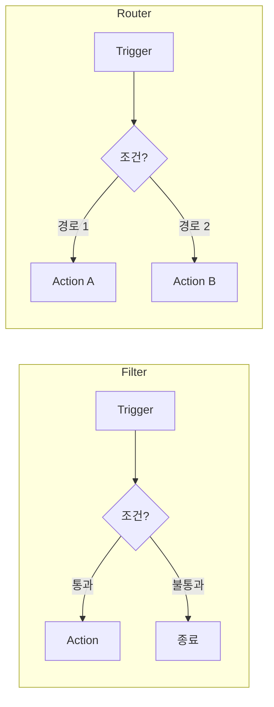

# 핵심 개념

| 개념 | 설명 | 예시 |
|---|---|---|
| **Trigger** | 워크플로우를 시작시키는 이벤트. 자동화당 1개 이상 | 폼 제출, 새 이메일, Webhook 수신, 정해진 시각 |
| **Action** | Trigger 이후 실행되는 처리 동작 | 시트에 행 추가, 메시지 전송, 메일 발송 |
| **Filter** | 조건을 만족할 때만 다음 단계로 진행, 아니면 **중단** | 점수 ≥ 80 일 때만 통과 |
| **Router** | 조건에 따라 **여러 경로로 갈라짐**. 경로마다 다른 Action 실행 | 80점 이상 → 합격 시트 / 미만 → 불합격 시트 |

## Filter vs Router

- Filter: "이 조건일 때**만** 실행" — 단일 경로
- Router: "이 조건이면 A, 저 조건이면 B" — 다중 경로

## 도구별 용어

| 개념 | Make | Zapier |
|---|---|---|
| 워크플로우 | Scenario | Zap |
| 실행 단위 | Operation | Task |
| 조건 분기 | Router (+ Filter) | Filter / Paths |
| 실행 기록 | Execution History | Zap History / Task History |
