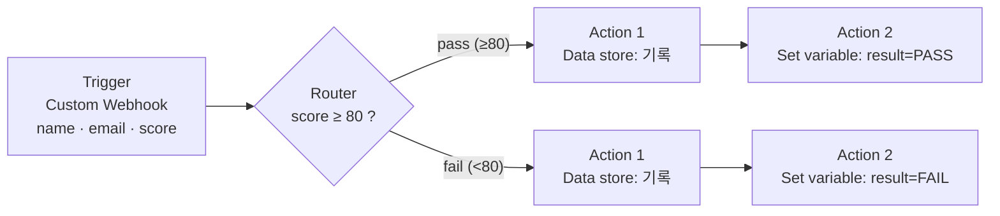

# 프로젝트 1 — 자동화 도구 비교 구현 (Make vs Zapier)

> ✅ **상태: Make · Zapier 두 도구 모두 구현, pass/fail 두 경로 실행 확인.** (Zapier 는 14일 Professional 체험판으로 구현 — 아래 '유료 기능' 참고)

## 워크플로우

**"Google Form 제출 → 점수 기준 조건 분기 → Google Sheets 기록 + 알림"**

> **실제 구현**: Google 계정 연동 없이 가능한 **Webhook + Router + Data store + Set variable** 조합으로 Make 에서 구현. (외부 알림 앱은 연동하지 않음)

## 공통 요구 충족 매핑

| 요구 | Make | Zapier |
|---|---|---|
| Trigger 1+ | Custom Webhook (폼 제출 대역) | Webhooks by Zapier – Catch Hook |
| 조건 분기 1+ | Router (`score ≥ 80` pass / `score < 80` fail) | Paths: Path A `score > 79`, Path B `score < 80` |
| Action 2+ | Data store – Update a record + Tools – Set variable (경로당 2개) | Email by Zapier – Send Outbound Email (경로당 1개, 총 2개) |
| 두 분기 모두 실행 확인 | ✅ pass 1회 ✅ fail 1회 | ✅ Path A 1회 (92점) ✅ Path B 1회 (55점) |

> **Zapier 유료 기능 사용**: *Webhooks by Zapier* 는 Premium 앱, *Paths* 는 상위 플랜 기능이며 14일 체험판 기간에만 사용 가능. 무료 대안은 보고서 참고.

## 테스트 데이터

| 이름 | 점수 | 기대 경로 |
|---|---|---|
| 테스트A | 92 | 합격 |
| 테스트B | 55 | 불합격 |

(더미 데이터만 사용 — [보안 점검표](../docs/security-checklist.md))

## 도구별 구현 기록

각 도구 폴더의 `screenshots/` 에 아래 파일명으로 캡처를 저장합니다.

### Make → `make/screenshots/`
| 파일 | 내용 |
|---|---|
| `01-scenario-overview.jpg` | 전체 시나리오 구성 (Router 포함) |
| `03-run-pass.jpg` | 합격(92점) 경로 실행 결과 — 1st 경로 ✓ |
| `04-run-fail.jpg` | 불합격(55점) 경로 실행 결과 — 2nd 경로 ✓ |

### Zapier → `zapier/screenshots/`
| 파일 | 내용 |
|---|---|
| `01-zap-overview.jpg` | 전체 Zap 구성 (Catch Hook → Paths A/B → Email) |
| `03-run-pass.jpg` | 92점 실행 — Path A 활성, Path B 차단 |
| `04-run-fail.jpg` | 55점 실행 — Path B 활성, Path A 차단 |
| `05-history.jpg` | Zap history (성공 2건) |

## 구현 과정 요약

**Make** (Scenario `Form Score Router (Make)`)
1. Custom webhook 생성 후 더미 JSON(`name`, `email`, `score`)을 전송해 데이터 구조를 자동 인식시킴.
2. Router 추가, 경로 1 filter `score ≥ 80`(label pass), 경로 2 filter `score < 80`(label fail).
3. 각 경로에 Data store(`score-results`) *Update a record* + Tools *Set variable* 추가.
4. `Run once` 로 92점(pass), 55점(fail) 데이터를 각각 보내 두 경로가 1회씩 실행됨을 확인.

**Zapier** (Zap `Form Score Router (Zapier)`)
1. Webhooks by Zapier – Catch Hook 으로 트리거 생성, 더미 JSON 전송 후 Test trigger 로 필드(Name/Email/Score) 인식.
2. Paths 추가: Path A 조건 `Score (Number) Greater than 79`, Path B 조건 `Score (Number) Less than 80`.
3. 각 Path 에 Email by Zapier – Send Outbound Email (제목 `[PASS]`/`[FAIL]`).
4. Publish 후 92점·55점을 각각 전송 → Zap history 에서 Path A / Path B 가 각각 1회씩 실행됨을 확인.
- 참고: 이메일 수신자는 placeholder 이며, 체험/무료 플랜에서는 테스트 메일이 계정 이메일로만 발송됨.

비교 분석은 [comparison-report.md](comparison-report.md).
