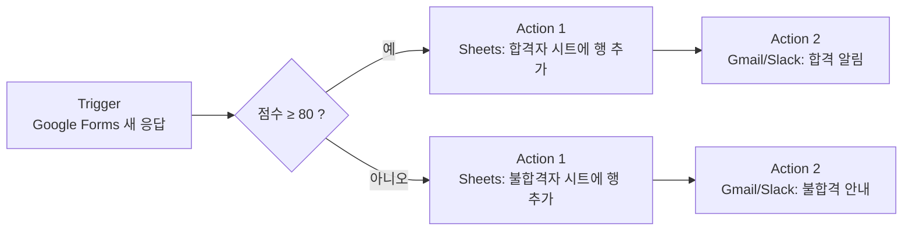

# 프로젝트 1 — 자동화 도구 비교 구현 (Make vs Zapier)

## 워크플로우

**"Google Form 제출 → 점수 기준 조건 분기 → Google Sheets 기록 + 알림"**

> 연동 앱은 계정 진입장벽이 낮은 **Google Sheets + Gmail(또는 Slack/Discord) + Webhook** 조합 권장. 실제 사용한 조합으로 아래 표를 수정하세요.

## 공통 요구 충족 매핑

| 요구 | Make | Zapier |
|---|---|---|
| Trigger 1+ | Google Forms – Watch Responses | Google Forms – New Response |
| 조건 분기 1+ | Router (점수 ≥ 80 / 그 외) | Paths 또는 Filter ×2 |
| Action 2+ | Sheets Add a Row + 알림 | Sheets Create Row + 알림 |
| 두 분기 모두 실행 확인 | [ ] 합격 1회 [ ] 불합격 1회 | [ ] 합격 1회 [ ] 불합격 1회 |

> Zapier 무료 플랜은 Paths/다중 단계 제약이 있을 수 있음. 막히면 Filter 2개 Zap으로 분리하고 그 이유를 보고서에 기록.

## 테스트 데이터

| 이름 | 점수 | 기대 경로 |
|---|---|---|
| 테스트A | 92 | 합격 |
| 테스트B | 55 | 불합격 |

(더미 데이터만 사용 — [보안 점검표](../docs/security-checklist.md))

## 도구별 구현 기록

각 도구 폴더의 `screenshots/` 에 아래 파일명으로 캡처를 저장합니다.

### Make → `make/screenshots/`
| 파일 | 내용 |
|---|---|
| `01-scenario-overview.png` | 전체 시나리오 구성 (Router 포함) |
| `02-router-filter.png` | Router 분기 조건 설정 |
| `03-run-pass.png` | 합격 경로 실행 결과 |
| `04-run-fail.png` | 불합격 경로 실행 결과 |
| `05-history.png` | Execution History |

### Zapier → `zapier/screenshots/`
| 파일 | 내용 |
|---|---|
| `01-zap-overview.png` | 전체 Zap 구성 |
| `02-filter-or-paths.png` | 분기 조건 설정 |
| `03-run-pass.png` | 합격 경로 실행 결과 |
| `04-run-fail.png` | 불합격 경로 실행 결과 |
| `05-history.png` | Zap/Task History |

## 구현 과정 요약

_(직접 구현하며 작성)_

**Make**
1. 
2. 

**Zapier**
1. 
2. 

비교 분석은 [comparison-report.md](comparison-report.md).
