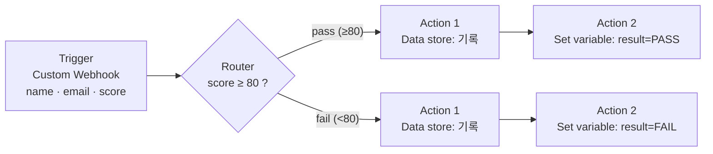

# 프로젝트 1 — 자동화 도구 비교 구현 (Make vs Zapier)

> ⚠️ **상태: Make 구현·검증 완료 / Zapier 미구현.** 과제 요건(도구 2개 이상)은 아직 충족하지 못함. Zapier 계정 로그인이 되지 않아 보류.

## 워크플로우

**"Google Form 제출 → 점수 기준 조건 분기 → Google Sheets 기록 + 알림"**

> **실제 구현**: Google 계정 연동 없이 가능한 **Webhook + Router + Data store + Set variable** 조합으로 Make 에서 구현. (외부 알림 앱은 연동하지 않음)

## 공통 요구 충족 매핑

| 요구 | Make | Zapier |
|---|---|---|
| Trigger 1+ | Custom Webhook (폼 제출 대역) | ⏳ 미구현 |
| 조건 분기 1+ | Router (`score ≥ 80` pass / `score < 80` fail) | ⏳ 미구현 |
| Action 2+ | Data store – Update a record + Tools – Set variable | ⏳ 미구현 |
| 두 분기 모두 실행 확인 | ✅ pass 1회 ✅ fail 1회 | ⏳ |

> Zapier 무료 플랜은 Paths/다중 단계 제약이 있을 수 있음. 막히면 Filter 2개 Zap으로 분리하고 그 이유를 보고서에 기록.

## 테스트 데이터

| 이름 | 점수 | 기대 경로 |
|---|---|---|
| 테스트A | 92 | 합격 |
| 테스트B | 55 | 불합격 |

(더미 데이터만 사용 — [보안 점검표](../docs/security-checklist.md))

## 도구별 구현 기록

각 도구 폴더의 `screenshots/` 에 아래 파일명으로 캡처를 저장합니다.

### Make → `make/screenshots/`
| 파일 | 내용 |
|---|---|
| `01-scenario-overview.jpg` | 전체 시나리오 구성 (Router 포함) |
| `03-run-pass.jpg` | 합격(92점) 경로 실행 결과 — 1st 경로 ✓ |
| `04-run-fail.jpg` | 불합격(55점) 경로 실행 결과 — 2nd 경로 ✓ |

### Zapier → `zapier/screenshots/`
| 파일 | 내용 |
|---|---|
| `01-zap-overview.png` | 전체 Zap 구성 |
| `02-filter-or-paths.png` | 분기 조건 설정 |
| `03-run-pass.png` | 합격 경로 실행 결과 |
| `04-run-fail.png` | 불합격 경로 실행 결과 |
| `05-history.png` | Zap/Task History |

## 구현 과정 요약

**Make** (Scenario `Form Score Router (Make)`)
1. Custom webhook 생성 후 더미 JSON(`name`, `email`, `score`)을 전송해 데이터 구조를 자동 인식시킴.
2. Router 추가, 경로 1 filter `score ≥ 80`(label pass), 경로 2 filter `score < 80`(label fail).
3. 각 경로에 Data store(`score-results`) *Update a record* + Tools *Set variable* 추가.
4. `Run once` 로 92점(pass), 55점(fail) 데이터를 각각 보내 두 경로가 1회씩 실행됨을 확인.

**Zapier**
- ⏳ 미수행 (계정 로그인 문제로 이번 제출 시점에 구현하지 못함). 과제 요건상 도구 2개 이상 필요하므로 **추후 구현 필요**.

비교 분석은 [comparison-report.md](comparison-report.md).
