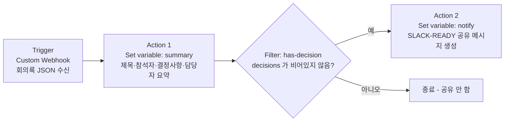

# 프로젝트 2 — 자유 주제 자동화 설계 및 구현

## 1. 반복 업무 정의

매주 회의 후 회의록을 정리해, **결정사항이 있는 회의록만** 요약해서 공유하는 작업.

- 빈도: 주 1~2회 / 1회 약 10분
- 문제: 요약 작성·공유 누락, 결정사항 없는 회의록까지 공유되는 노이즈

## 2. 도구 선정 및 이유

**선정: Make**

- Webhook 트리거가 **즉시(Instant) 자동 실행**되어 "Trigger 발생 시 자동 실행" 요건을 만족
- 무료 플랜(Operations) 안에서 구현 가능, Google 계정 연동 없이도 구성 가능
- 실행 History 에서 실행별 Operations 수로 필터 통과/차단을 확인 가능
- 프로젝트 1에서 이미 쓴 도구라 구성·디버깅이 빠름

## 3. 워크플로우 설계 (Scenario `Meeting Notes Auto Share (Make)`)



| 단계 | 모듈 | 설명 |
|---|---|---|
| Trigger | Webhooks – Custom webhook | `title`, `attendees`, `decisions`, `owner` JSON 수신 → **자동 실행** |
| Action 1 | Tools – Set variable `summary` | `[제목] attendees / decision / owner` 형태로 요약 문자열 생성 |
| Filter | `has-decision` | `decisions` 가 비어있지 않을 때만 통과 |
| Action 2 | Tools – Set variable `notify` | `SLACK-READY {{summary}}` 공유용 메시지 생성 |

### 입력 예시
```json
{"title":"주간 회의 2","attendees":"A, B, C","decisions":"디자인 시안 확정","owner":"B"}
```

### 한계 (솔직히)
- **실제 Slack 전송과 시트 이력 기록은 구현하지 못함.** Slack/Google 연동은 계정 허용이 필요했고, 시도한 Data store(이력용)는 무료 플랜 저장 용량(1MB)을 첫 프로젝트에서 이미 사용해 만들 수 없었음.
- 그래서 "공유 메시지 생성"(`notify` 변수)까지만 구현. 실제 전송은 `Set variable` 자리를 Slack *Send a Message* 모듈로 교체하면 됨.
- 이 한계를 무료 플랜 제약으로 인한 대체 설계로 기록함 (유료 불필요: Data store 정리 후 재사용 또는 Slack 연동으로 해결 가능).

## 4. 구현 · 실행 증거 (`screenshots/`)

| 파일 | 내용 |
|---|---|
| `01-scenario-overview.jpg` | 전체 구성 (Webhook → Set summary → filter `has-decision` → Set notify) |
| `03-trigger-auto-run-history.jpg` | History 의 `Instant` 자동 실행 2건 |

- **자동 실행 확인**: 시나리오를 *Active* 로 두고 `curl` 로 웹훅만 보냄 → 사람이 Run once 를 누르지 않았는데 History 에 `Instant` 실행이 기록됨.
- **필터 통과 경로**: 결정사항 있는 회의록(주간 회의 2) → Operations **3** (Webhook, Set summary, Set notify)
- **필터 차단 경로**: 결정사항이 빈 회의록(주간 회의 3) → Operations **2** (Webhook, Set summary 후 필터에서 중단)

## 5. 실행 결과 설명

1. 결정사항 있는 회의록 전송 → 요약 생성 → 필터 통과 → 공유 메시지 생성까지 완료.
2. 결정사항이 비어 있는 회의록 전송 → 요약 생성 후 필터에서 중단, 공유 메시지 미생성.
3. 두 실행 모두 History 에서 `Success`, Operations 수 차이(3 vs 2)로 분기 결과를 구분.

## 6. 개선점

- Slack *Send a Message* 로 실제 전송, Sheets 로 이력 기록
- 요약 생성에 생성형 AI 추가 ([보너스](../bonus/README.md))
- 오류 시 알림/재시도 경로 추가
