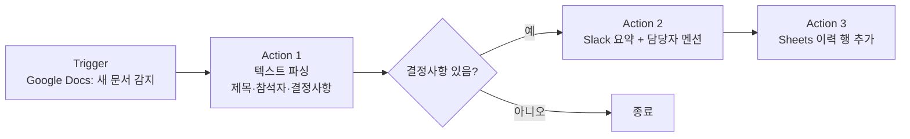

# 프로젝트 2 — 자유 주제 자동화 설계 및 구현

> 아래는 **초안(예시 주제)** 입니다. 실제로 구현한 업무에 맞게 수정하세요.

## 1. 반복 업무 정의

매주 회의 후 회의록을 Google Docs에 작성하면, 핵심 내용을 정리해 Slack 채널에 공유하고 이력을 시트에 남기는 작업.

- 빈도: 주 1~2회 / 1회 약 10분
- 문제: 공유 누락, 이력 관리 안 됨

## 2. 도구 선정 및 이유

**선정: Make**

- 분기·데이터 가공을 시각적으로 설계하기 쉬움
- 무료 Operations 범위 내 구현 가능
- 실행 히스토리로 단계별 데이터 확인 가능

## 3. 워크플로우 설계

| 단계 | 모듈 | 설명 |
|---|---|---|
| Trigger | Google Docs – Watch Documents | 지정 폴더의 새 문서 감지 → **자동 실행** |
| Action 1 | Text parser / Get a Document Content | 제목·참석자·결정사항 추출 |
| Filter | 결정사항 not empty | 없으면 이후 단계 중단 |
| Action 2 | Slack – Send a Message | 요약 + 담당자 멘션 |
| Action 3 | Google Sheets – Add a Row | 회의록 이력 기록 |

## 4. 구현 · 실행 증거 (`screenshots/`)

| 파일 | 내용 |
|---|---|
| `01-scenario-overview.png` | 전체 구성 |
| `02-filter.png` | 필터 조건 |
| `03-trigger-auto-run.png` | Trigger 발생 후 **자동 실행** 확인 |
| `04-result-slack.png` | Slack 결과 |
| `05-result-sheet.png` | 시트 결과 |
| `06-filter-blocked.png` | 결정사항 없음 → 중단된 실행 (분기 확인) |

- [ ] 자동 실행 확인 (Scheduling = Immediately / 주기 설정)
- [ ] 필터 통과 · 차단 경로 모두 1회 이상 실행
- [ ] 민감정보 마스킹 ([점검표](../docs/security-checklist.md))

## 5. 실행 결과 설명

_(실제 실행 결과를 단계별로 서술)_

## 6. 한계 및 개선점

_(예: 문서 형식이 바뀌면 파싱 실패 → 보너스의 실패 알림으로 보완)_
